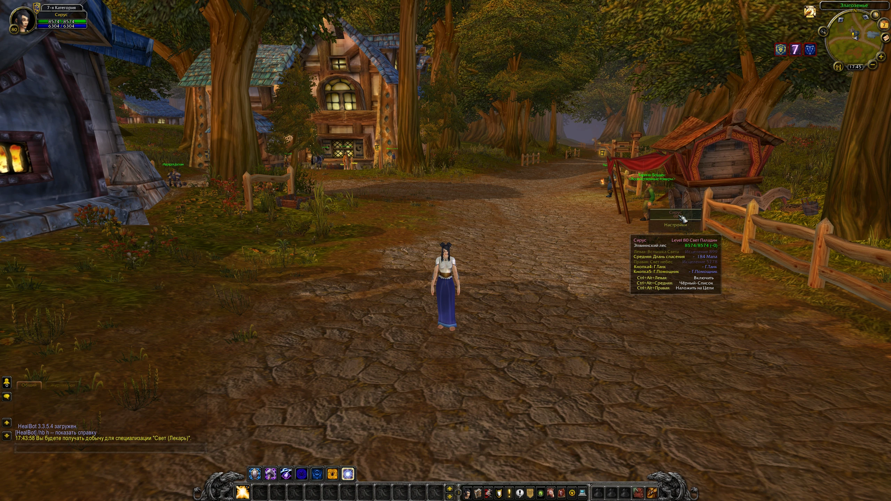
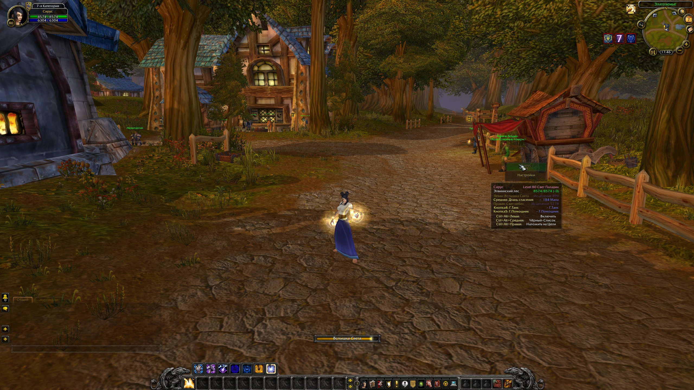
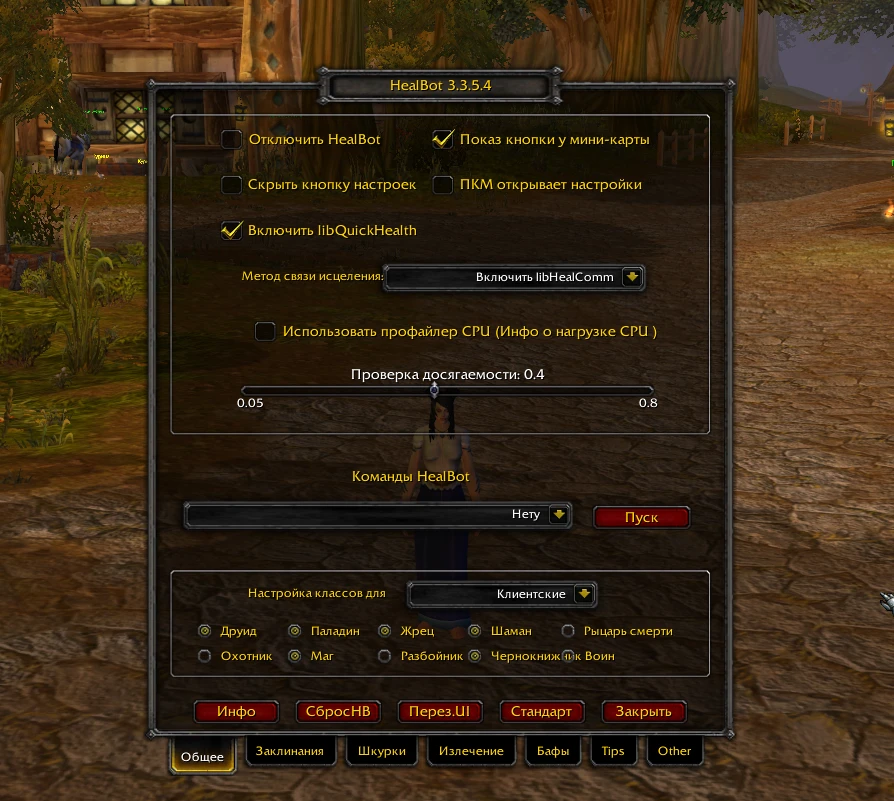
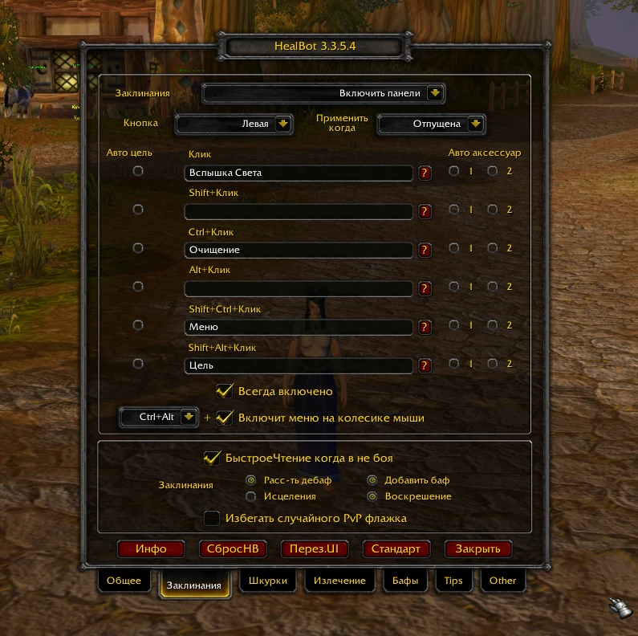
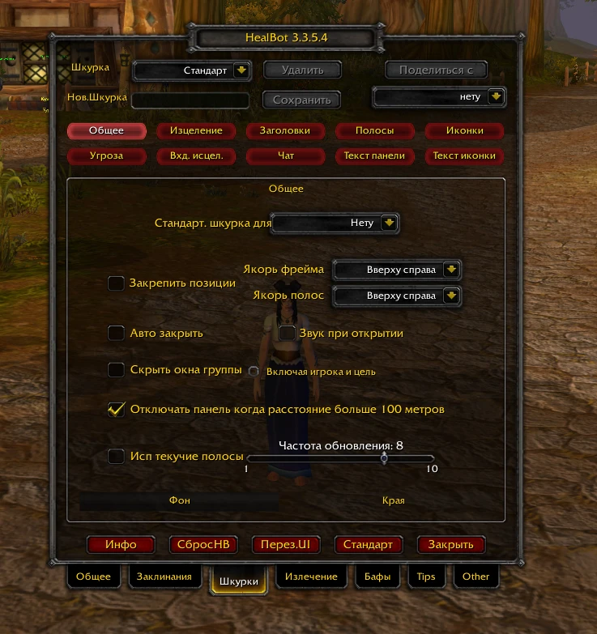
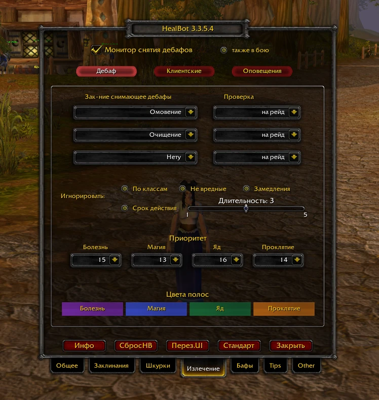
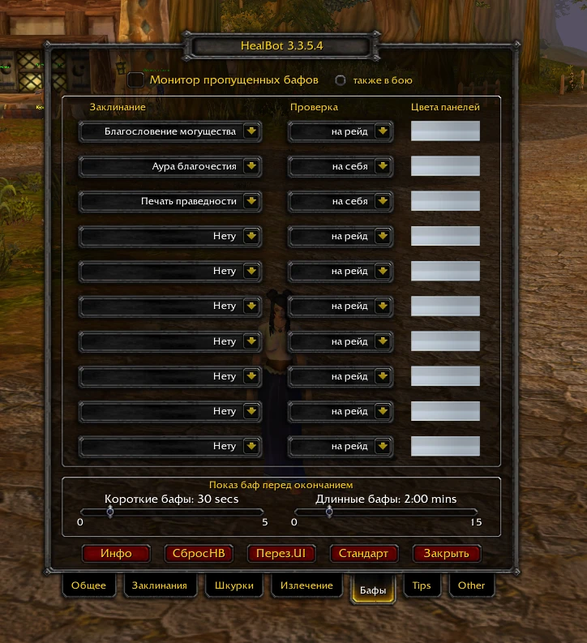
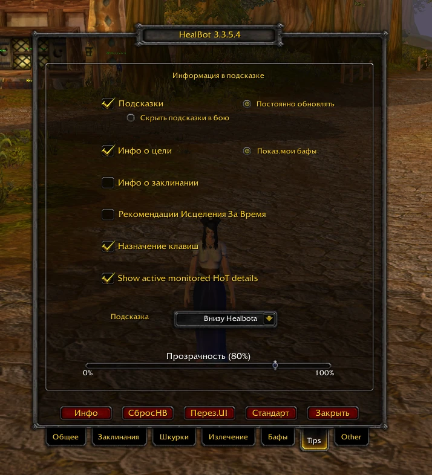
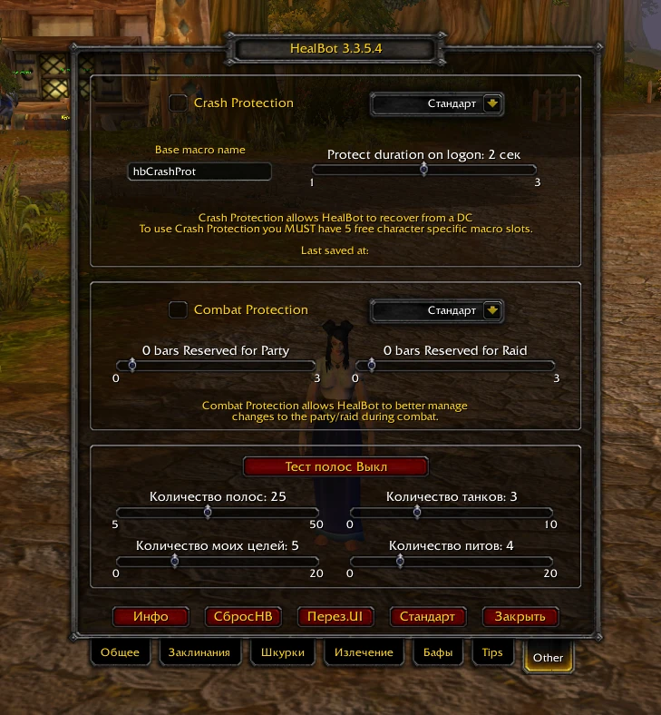

**HealBot** - модификация отображает всех игроков в группе или рейде в одной удобной панели. Функционал аддона не заканчивается этим, у него множество других возможностей, которые делают его буквально незаменимым помощником хила в рейде, как в PvE. так и в PvP.

Особенности:
- Жесты мышкой - достаточно просто водить мышкой по панели для отхила участников группы;
- Отображение бафов и дебафов на панели;
- Возможность создавать сложные комбинации, в которые можно добавлять свои макросы;
- Отображение танков и хилов рейда на панели.

Настройка:\
/healbot - окно модификации;\
/healbot options - окно настройки модификации.

**Скриншоты:**

